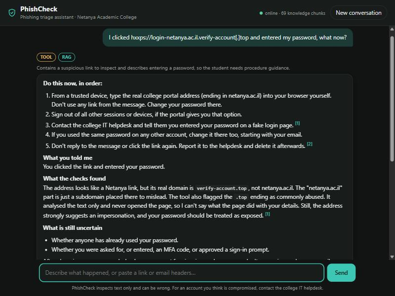
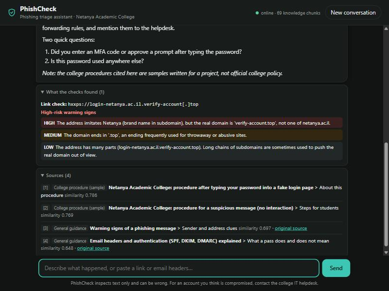
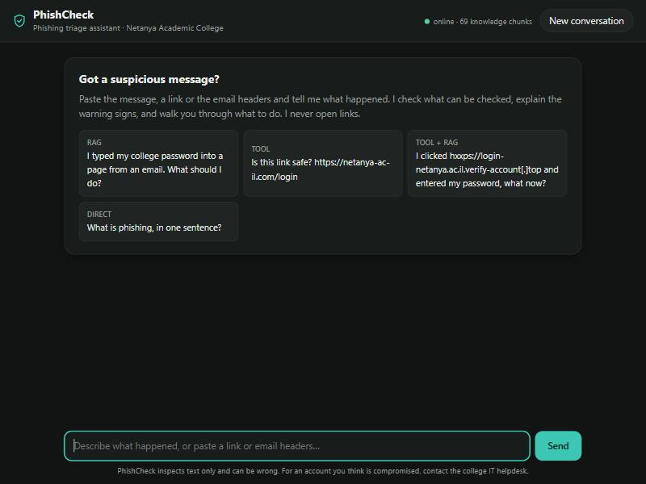
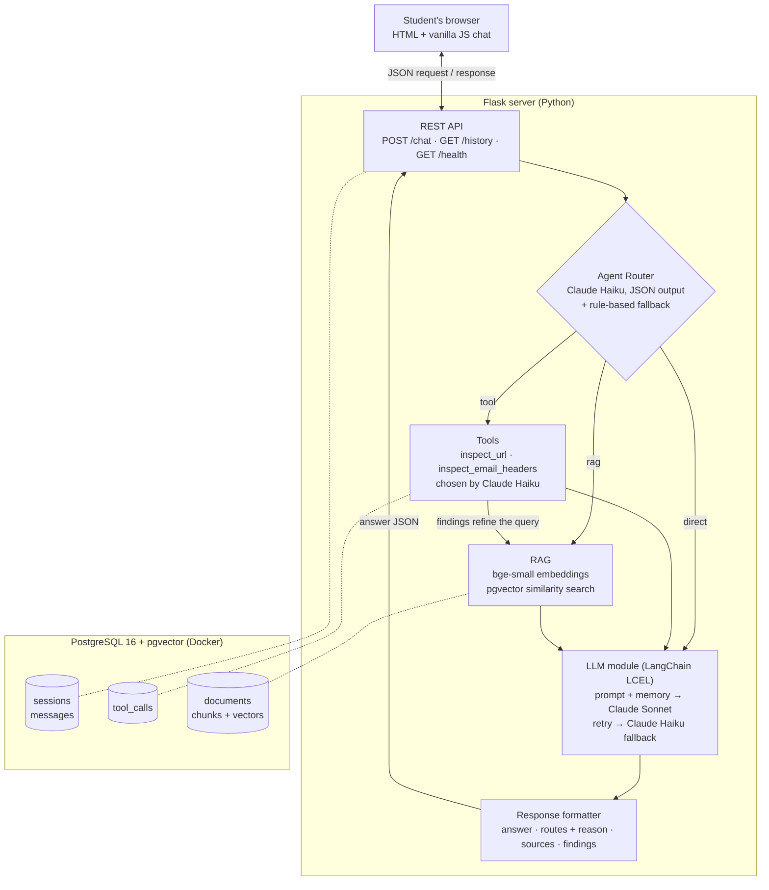

# PhishCheck: a phishing triage assistant

**[English](#english) · [עברית](#עברית)**

PhishCheck helps students at Netanya Academic College check suspicious messages and figure out what to do next. A student can paste a message, a link or email headers, and explain what happened. The app checks the details it can, looks up the relevant procedure, and can put together a report for the IT helpdesk.

Final project for *Advanced AI-Assisted Programming*.



### What the app does

The router decides whether a message needs a tool, a search through the knowledge base (RAG), a direct answer, or both a tool and RAG. It also explains why it chose that route, so you can see how the message was handled.

There are two tools: one checks URLs and the other checks email headers. They work on the pasted text without opening links. The knowledge base contains general phishing guidance and sample college procedures, stored in PostgreSQL with pgvector. LangChain LCEL connects the answer prompt, conversation history, retries and fallback model.

The app works in Hebrew and English, with a plain HTML/JavaScript interface and a database running in Docker. There are 40 automated tests. The setup below was also checked on a fresh clone. Screenshots of the demo (RAG, tool and direct answers) and of the security testing are in [DEMO.md](DEMO.md).

A link with no obvious warning signs can still be dangerous. The assistant is instructed to explain what it found and what it cannot check, rather than tell the student that something is safe.

<p>
  
  
</p>

---

<a id="english"></a>

## English

### Contents

1. [The problem and the user](#1-the-problem-and-the-user)
2. [Architecture](#2-architecture)
3. [Components](#3-components)
4. [API](#4-api)
5. [Setup and running](#5-setup-and-running)
6. [Tests](#6-tests)
7. [Project structure](#7-project-structure)
8. [Limitations](#8-limitations)
9. [Sources and AI use](#9-sources-and-ai-use)

### 1. The problem and the user

A student gets an email saying their college account will be closed today unless they log in through a link. What should they do? That depends on whether they only received the email, opened the link, or already entered their password and possibly an MFA code.

PhishCheck is meant for a student in that situation. Security guidance is available, but finding the right steps while dealing with the message can be difficult. The app uses the student's description, tool findings and retrieved procedures to explain the next steps.

It covers three scenarios:

1. The student received a suspicious message and has not interacted with it.
2. They opened a suspicious link.
3. They entered a password, and possibly an MFA code, on a page that may be fake.

The answer should make clear what the student reported, what the tools actually found and what is still unknown. It should not claim that a message is safe.

### 2. Architecture

Three tiers: a plain HTML/JavaScript client, a Flask server that owns all AI logic, and PostgreSQL with pgvector running in Docker.



Solid arrows are the request path; dotted lines are database reads and writes. The router, the tool selection and the LLM module call Claude through the Anthropic API.

**Request flow for `POST /chat`:**

1. The server loads the session's recent messages (conversation memory) and stores the new message.
2. **Agent Router** decides the route(s): `tool`, `rag`, `direct`, or `tool` + `rag` in one message (for example, a link plus "I entered my password, what now?").
3. **Tools** (if routed): Claude selects which tool(s) to call; results are logged to `tool_calls`.
4. **RAG** (if routed): the router's English search query, enriched with the tools' findings, is embedded and matched against the knowledge base.
5. **LLM module**: one LCEL chain builds the final prompt from the system instructions, memory, tool results and retrieved documents, and calls Claude.
6. **Response formatter** returns JSON with the answer, the route and its reason, the sources with similarity scores, and the tool findings. The answer is stored for memory.

### 3. Components

#### Agent Router (`server/router.py`)

Claude Haiku 5.5 reads the message and returns structured JSON with `routes`, `reason` and `search_query`. This runs through an LCEL chain: `prompt | model.with_structured_output(...)`.

The search query is written in English and includes the relevant context from earlier messages. For example, if the student asks "so what do I do now?", the query still needs to include what happened before. This also allows Hebrew questions to search the English knowledge base.

If the model call fails, regex and keyword rules choose the route instead. The interface shows which router was used, along with a one-sentence explanation stored in `messages.route_reason`.

When a message needs both tools and RAG, the tools run first. Their findings can then be included in the search query.

#### Tools (`server/tools.py`, `server/tool_runner.py`)

Both tools use the Anthropic tool-use schema: `name`, `description` and `input_schema`. They only analyse the text they receive. They do not visit websites, resolve DNS, open attachments or connect to a mailbox.

| Tool | What it checks |
|---|---|
| `inspect_url` | The hostname and registrable domain, `user@host` tricks, IP addresses used as hosts, punycode, mixed alphabets, brand impersonation and similar spellings such as `netanyaa.ac.il`. It also checks shorteners, embedded redirects and risky TLDs. Defanged links such as `hxxp://evil[.]com` are accepted. |
| `inspect_email_headers` | From, Reply-To, Return-Path, SPF/DKIM/DMARC results, DKIM signing domains and the claimed origin IP. It flags mismatched domains, display-name spoofing, free-mail accounts claiming to represent an organisation, lookalike domains and failed or missing authentication. |

The result includes an assessment (`high_risk_indicators`, `warning_signs` or `no_structural_red_flags`) and the limits of the check. Finding no structural red flags does not prove the link or email is safe.

Claude Haiku receives the schemas and chooses the tools and inputs using `tool_choice: auto`; the 5.5 models do not accept forced tool use. If it chooses no tool, or the API call fails, the app uses regular expressions to extract links and header blocks. Each tool call is saved in `tool_calls`, including its input, output, success status, error and duration.

#### RAG (`server/rag.py`, `scripts/ingest.py`, `knowledge/`)

The knowledge base has 14 Markdown documents: 10 general guides and 4 sample college procedures.

The general guides were written for the project using public CISA and UK NCSC guidance. They cover warning signs, message verification, clicked links, password exposure, MFA codes and fatigue, attachments, reporting, account recovery, email authentication, and SMS, phone and QR phishing.

The college procedures cover suspicious messages, clicked links, exposed credentials and helpdesk reports. These are examples for the course project. The `{{COLLEGE_NAME}}`, `{{COLLEGE_DOMAIN}}` and `{{HELPDESK}}` placeholders are filled from `.env` during ingestion.

**Chunking.** Each `##` section becomes one chunk, with the document title and section heading added to the text used for embedding. This keeps a numbered procedure together instead of cutting it halfway through a step. Sections longer than 1,800 characters are split at paragraph boundaries, though none currently need this. The result is 69 chunks.

**Embeddings and storage.** `BAAI/bge-small-en-v1.5` runs locally through sentence-transformers. It produces 384-dimensional vectors and accepts up to 512 tokens. The model is about 130 MB and downloads on the first run; it needs no additional API key. The vectors are stored in PostgreSQL with pgvector and an HNSW index using cosine distance, in the same container as the rest of the database.

**Retrieval.** The similarity cutoff is 0.62. In the test queries used to choose it, relevant questions scored at least 0.65, while unrelated ones, such as "how does a firewall work?", scored at most about 0.61. This cutoff was chosen from those results; other questions may behave differently.

College procedures and general guides are searched separately and then combined: two results from each when both have relevant matches, with the other group filling any free places, up to four in total. Otherwise, one group could take up all the results and leave out useful steps from the other. The interface shows the retrieved sources and their similarity scores.

#### LLM module (`server/llm.py`)

The answer chain combines a `ChatPromptTemplate`, conversation history through `MessagesPlaceholder`, tool findings, retrieved documents and the student's message. Claude Sonnet 5.5 writes the answer, with Claude Haiku 5.5 as the fallback. Text extraction runs inside each model branch, so an empty answer can also trigger the fallback.

The session's last 10 turns are loaded from PostgreSQL. Saving the history there means the conversation can continue after a server restart.

Connection errors, rate limits, timeouts and server errors trigger retries. If Sonnet still fails or returns no text, Haiku gets the request. If both return empty answers, the student gets a short message in Hebrew or English asking for the suspicious content or an explanation of what happened. If neither model can answer because of an API failure, the server returns `503`.

The prompt tells the model to give urgent steps first when credentials may have been exposed, ask at most two follow-up questions and cite retrieved documents as `[1]`, `[2]`, and so on. It should answer in the student's language and distinguish reported facts from tool findings and uncertainty. Pasted messages, tool output and retrieved documents are treated as data, even if they contain instructions aimed at the assistant.

The models use `effort: low` to keep response times down. The 5.5 models use adaptive thinking by default.

#### Response formatter (`server/formatter.py`)

Builds the JSON response shown below, including the answer, routing decision, sources and tool findings. The client uses those fields to display the result.

#### Database (`db/init.sql`)

| Table | Contents |
|---|---|
| `sessions` | One row per conversation (UUID created by the client) |
| `messages` | Every user and assistant message, with the routes, the router's reason and the sources used |
| `tool_calls` | Every tool invocation: tool name, input, output, success, error, duration, and the answer it belonged to |
| `documents`, `chunks` | Knowledge base: document metadata, chunk text and `vector(384)` embeddings |
| `eval_results` | Router evaluation runs (expected vs. actual routes) |

The schema runs automatically the first time the Docker volume is created.

#### Error handling

| Situation | Behaviour |
|---|---|
| Malformed request (not JSON, missing or empty fields, bad session ID, too long) | `400` with a message |
| Empty knowledge base | `200`; the answer says no documents were found and gives only cautious general advice |
| A tool fails | Logged as failed; the model is told the tool failed and explains it |
| Router LLM fails | Rule-based routing takes over |
| Answer model fails | Retry, then fallback model, then `503` with a message (a specific message for an invalid API key) |
| Too many requests from one IP | `429` with `Retry-After`; the default limits are 10 messages per minute and 200 per day |
| Database down | `503` "The database is unavailable…"; `/health` reports `unreachable` |
| Any other unexpected error | Logged; `500` with a generic message, never a stack trace |

### 4. API

`POST /chat`

```json
{ "session_id": "6f1c…-uuid", "message": "I clicked https://netanya-ac-il.com/login and typed my password" }
```

Response:

```json
{
  "session_id": "6f1c…",
  "message_id": 42,
  "answer": "**Act now, since you typed your password:** …",
  "routes": ["tool", "rag"],
  "route_reason": "Contains a link to inspect and describes entering a password…",
  "router": "llm",
  "sources": [
    {"n": 1, "title": "Netanya Academic College: procedure after typing your password into a fake login page",
     "heading": "Steps for students", "source_type": "college", "source_url": null, "score": 0.826}
  ],
  "tool_calls": [
    {"tool": "inspect_url", "input": "https://netanya-ac-il.com/login", "selected_by": "llm",
     "assessment": "high_risk_indicators",
     "indicators": [{"severity": "high", "detail": "The address imitates Netanya (brand name in domain)…"}],
     "error": null}
  ],
  "timings_ms": {"router": 1900, "tools": 900, "rag": 25, "llm": 4300}
}
```

`GET /history?session_id=<uuid>` returns `{"session_id": …, "messages": [{role, content, routes, route_reason, sources, created_at}, …]}`.

`GET /health` returns `{"status": "ok", "database": "ok", "knowledge_chunks": 69, "llm_configured": true}`, or `503` if the database is unreachable.

### 5. Setup and running

**Requirements:** Python 3.10 or newer (developed on 3.12), Docker Desktop (or Docker Engine with Compose), Git, and an Anthropic API key.

```bash
# 1. Get the code
git clone https://github.com/stateOfMindset/phishcheck.git
cd phishcheck

# 2. Configuration: copy the template, then edit .env
#    - ANTHROPIC_API_KEY: your key
#    - POSTGRES_PASSWORD: any password of your choice
cp .env.example .env            # Windows PowerShell: Copy-Item .env.example .env

# 3. Start the database (creates the schema on first start)
docker compose up -d

# 4. Python environment
python -m venv .venv
source .venv/bin/activate        # Windows PowerShell: .venv\Scripts\Activate.ps1
pip install -r requirements.txt

# 5. Load the knowledge base (first run downloads the embedding model, ~130 MB)
python -m scripts.ingest

# 6. Start the server, then open http://127.0.0.1:5000
python run.py
```

Check it: `http://127.0.0.1:5000/health` should show `"status": "ok"` and `"knowledge_chunks": 69`.

To use another college, change `COLLEGE_NAME`, `COLLEGE_DOMAIN` and optionally `HELPDESK_EMAIL` in `.env`, run `python -m scripts.ingest` again and restart the server.

To reset the database completely: `docker compose down -v` and then `docker compose up -d` (this deletes all conversations).

**Troubleshooting**

- *`CERTIFICATE_VERIFY_FAILED` errors:* antivirus HTTPS scanning (e.g. AVG, Avast) or a corporate proxy. PhishCheck already uses the operating system's certificate store through `truststore`. If `pip install` itself fails, use Python 3.10+ with a recent pip, which does the same.
- *Port 5433 or 5000 already in use:* change `POSTGRES_PORT` or `FLASK_PORT` in `.env`.
- *`/health` says the database is unreachable:* check that Docker Desktop is running and that `docker compose ps` shows the `db` service as healthy.

### 6. Tests

```bash
python -m pytest
```

The project has 40 automated tests. They cover URL and email-header checks, document chunking, empty model answers and rate limiting. Cases include lookalike domains, defanged links, spoofed display names, failed authentication, invalid input and legitimate-looking messages that must still not be called safe. The chunking tests check placeholder replacement, complete numbered steps, long sections and invalid documents. These tests need no running database or API key.

### 7. Project structure

```
phishcheck/
├── client/                 HTML, CSS and JavaScript chat client
├── server/
│   ├── app.py              Flask app: REST API, error handlers, serves the client
│   ├── pipeline.py         Router → tools → RAG → LLM → formatter
│   ├── router.py           Agent Router (LLM + rules)
│   ├── tools.py            Tool implementations and Anthropic tool schemas
│   ├── tool_runner.py      Tool selection by Claude, execution, logging
│   ├── rag.py              Chunking, embeddings, pgvector retrieval
│   ├── llm.py              LCEL answer chain, memory, retry/fallback
│   ├── formatter.py        JSON response contract
│   ├── ratelimit.py        Per-IP rate limit for /chat
│   ├── db.py               PostgreSQL access
│   └── config.py           Settings from .env
├── knowledge/
│   ├── general/            General guidance (CISA / UK NCSC based)
│   └── college/            Sample college procedures
├── scripts/ingest.py       Loads the knowledge base into pgvector
├── db/init.sql             Database schema
├── tests/                  Pytest tests
├── docs/screenshots/       Images used in this README
├── docs/demo/              Screenshots used in DEMO.md
├── DEMO.md                 Demo and security-testing screenshots
├── docker-compose.yml      PostgreSQL 16 + pgvector
├── run.py                  Starts the server
├── requirements.txt        Pinned Python dependencies
└── .env.example            Configuration template
```

### 8. Limitations

- The college procedures are **samples written for this course project**, not official policy of Netanya Academic College, and no real helpdesk contact details are included.
- The tools inspect structure only. They cannot see the page behind a link or the content of an attachment, and they cannot prove a message is safe.
- Pasted headers can be edited by whoever pastes them, so authentication results are only as reliable as their source.
- The knowledge base and embeddings are in English. Hebrew questions work because the router writes an English search query.
- There are no user accounts, and conversations are kept indefinitely. The app is a course project; these privacy and access limitations matter if it is made available to other users.

### 9. Sources and AI use

General guidance was written for this project, based on:

- CISA: [Recognize and Report Phishing](https://www.cisa.gov/secure-our-world/recognize-and-report-phishing), [Turn On MFA](https://www.cisa.gov/secure-our-world/turn-mfa)
- UK NCSC: [Phishing scams: how to spot and report them](https://www.ncsc.gov.uk/collection/phishing-scams), [Recovering a hacked account](https://www.ncsc.gov.uk/guidance/recovering-a-hacked-account), [Report a scam email](https://www.ncsc.gov.uk/collection/phishing-scams/report-scam-email)

Claude (Anthropic) was used as a coding assistant during development. Commits with Claude contributions are marked `Co-Authored-By: Claude`. The documentation was also rewritten with help from ChatGPT/Codex.

---

<a id="עברית"></a>

<div dir="rtl">

## עברית

### תוכן העניינים

1. [הבעיה והמשתמש](#1-הבעיה-והמשתמש)
2. [ארכיטקטורה](#2-ארכיטקטורה)
3. [רכיבים](#3-רכיבים)
4. [ממשק התקשורת](#4-ממשק-התקשורת)
5. [התקנה והרצה](#5-התקנה-והרצה)
6. [בדיקות](#6-בדיקות)
7. [מגבלות](#7-מגבלות)
8. [מקורות ושימוש בבינה מלאכותית](#8-מקורות-ושימוש-בבינה-מלאכותית)

### 1. הבעיה והמשתמש

סטודנט מקבל מייל שאומר שהחשבון שלו במכללה ייסגר היום אם הוא לא יתחבר דרך הקישור המצורף. מה הוא אמור לעשות עכשיו? זה תלוי במה שכבר קרה: האם הוא רק קיבל את המייל, פתח את הקישור, או גם הזין סיסמה ואולי קוד אימות.

PhishCheck מיועד לסטודנט שנמצא במצב הזה. יש הנחיות אבטחה, אבל לא תמיד קל למצוא את הצעדים המתאימים בזמן שמתמודדים עם הודעה חשודה. האפליקציה משתמשת בתיאור של הסטודנט, בתוצאות הבדיקות ובנהלים שנשלפו ממאגר הידע כדי להסביר איך להמשיך.

הפרויקט מתייחס לשלושה מצבים:

1. הסטודנט קיבל הודעה חשודה ועדיין לא עשה איתה דבר.
2. הוא פתח קישור חשוד.
3. הוא הזין סיסמה, ואולי גם קוד אימות, בדף שעלול להיות מזויף.

התשובה צריכה להבהיר מה הסטודנט סיפר, מה הכלים מצאו ומה עדיין לא ידוע. היא לא אמורה לקבוע שההודעה בטוחה.

### 2. ארכיטקטורה

שלוש שכבות: ממשק משתמש פשוט בדפדפן, שרת שמחזיק את כל הלוגיקה של הבינה המלאכותית, ומסד נתונים שרץ בקונטיינר. התרשים המלא מופיע [בחלק האנגלי](#2-architecture).

**מסלול של הודעה:**

1. השרת טוען את ההודעות האחרונות בשיחה (זיכרון השיחה) ושומר את ההודעה החדשה.
2. **הנתב** מחליט איך לטפל בהודעה: בדיקה בכלי, חיפוש במאגר הידע, תשובה ישירה, או גם בדיקה בכלי וגם חיפוש במאגר באותה הודעה (למשל קישור יחד עם "הכנסתי את הסיסמה, מה עושים?").
3. **הכלים** (אם נבחרו): המודל בוחר איזה כלי להפעיל ועל מה. כל הפעלה נשמרת במסד הנתונים.
4. **אחזור מידע** (אם נבחר): שאילתת החיפוש שהנתב כתב, יחד עם ממצאי הכלים, מומרת לייצוג מספרי ומושווית למאגר הידע.
5. **מודול השפה**: שרשרת אחת בונה את ההנחיה הסופית מההוראות, מהזיכרון, מתוצאות הכלים ומהמסמכים, ושולחת אותה למודל.
6. **מעצב התגובה** מחזיר את התשובה, את המסלול והסיבה לבחירתו, את המקורות עם ציוני הדמיון ואת ממצאי הכלים.

### 3. רכיבים

הנתב (`server/router.py`) משתמש ב־Claude Haiku כדי לבחור איך לטפל בהודעה. הוא מחזיר את המסלולים, הסבר קצר ושאילתת חיפוש באנגלית. השאילתה כוללת גם מידע מהשיחה הקודמת, כך ששאלת המשך כמו "אז מה עושים עכשיו?" עדיין יכולה למצוא את הנוהל המתאים. אם הקריאה למודל נכשלת, כללי חיפוש קבועים בוחרים את המסלול. המשתמש רואה את הבחירה ואת הסיבה לה.

יש שני כלי בדיקה, שמוגדרים לפי מבנה הפעלת הכלים של Anthropic. אחד בודק קישורים והשני בודק כותרות מייל. שניהם עובדים על הטקסט שהודבק, בלי להיכנס לאתר, לפתוח קובץ או להתחבר לתיבת דואר.

- בדיקת הקישורים מחלצת את שם המתחם האמיתי ומחפשת ניסיונות הסוואה, כתובות IP, אותיות דומות, התחזות לשם של ארגון, קיצורי קישורים והפניות בתוך הכתובת.
- בדיקת כותרות המייל משווה בין השולח, כתובת התשובה ו־Return-Path, ובודקת את תוצאות SPF, DKIM ו־DMARC. היא מסמנת אי־התאמות, התחזות בשם התצוגה ובדיקות אימות שנכשלו או חסרות.

כל תוצאה כוללת גם את מגבלות הבדיקה. אם לא נמצאו סימנים חשודים במבנה הקישור, זה עדיין לא אומר שהאתר בטוח. כל הפעלת כלי נשמרת במסד הנתונים עם הקלט, הפלט, משך הבדיקה ושגיאות אם היו.

מאגר הידע כולל 14 מסמכים: 10 מדריכים כלליים שנכתבו לפרויקט על בסיס הנחיות CISA ו־NCSC, ו־4 נהלים לדוגמה של המכללה. אלה אינם נהלים רשמיים.

המסמכים מחולקים לפי כותרות, כדי לשמור כל נוהל ממוספר יחד ולא לחתוך אותו באמצע. בסך הכול יש 69 קטעים. מודל ההטמעה המקומי `BAAI/bge-small-en-v1.5` ממיר אותם לווקטורים, שנשמרים ב־PostgreSQL עם pgvector. אין צורך במפתח API נוסף עבור ההטמעות.

סף הדמיון לחיפוש הוא 0.62. בשאלות ששימשו לבדיקה, שאלות רלוונטיות קיבלו לפחות 0.65 ושאלות לא קשורות קיבלו עד כ־0.61. הסף נבחר לפי התוצאות האלה, ולכן הוא לא מבטיח שכל שאלה חדשה תסווג באותה הצלחה. הנהלים של המכללה והמדריכים הכלליים נשלפים בנפרד ואז משולבים: שני קטעים מכל קבוצה כשבשתיהן יש התאמות רלוונטיות, והקבוצה השנייה משלימה מקומות פנויים, עד ארבעה קטעים בסך הכול. המקורות וציוני הדמיון מוצגים בתשובה.

מודול השפה (`server/llm.py`) משתמש בשרשרת LCEL שמחברת את ההוראות, היסטוריית השיחה, תוצאות הכלים והמסמכים שנשלפו. Claude Sonnet כותב את התשובה. עשרת סבבי השיחה האחרונים נטענים ממסד הנתונים, כך שאפשר להמשיך את השיחה גם אחרי הפעלה מחדש של השרת.

אם יש תקלה זמנית, מתבצע ניסיון חוזר. אם Sonnet עדיין נכשל או מחזיר תשובה ריקה, הבקשה עוברת ל־Claude Haiku. אם שני המודלים מחזירים תשובה ריקה, מוצגת הודעה קצרה בעברית או באנגלית שמבקשת את התוכן החשוד או הסבר על מה שקרה. תקלת API שלא נפתרת מחזירה `503`.

ההוראות למודל דורשות להתחיל בצעדים הדחופים כשייתכן שסיסמה נחשפה, לשאול לכל היותר שתי שאלות המשך, לציין מקורות ולענות בשפה של הסטודנט. תוכן שהודבק, מסמכים ותוצאות כלים נחשבים למידע לבדיקה, גם אם מופיעות בהם הוראות לעוזר.

מסד הנתונים שומר שיחות, הודעות, החלטות ניתוב, הפעלות כלים, מסמכים ותוצאות הערכה של הנתב. השרת מטפל בקלט פגום, מאגר ידע ריק, כשל בכלי ותקלות במודל או במסד הנתונים, ומחזיר הודעה מתאימה. בקשות ל־`/chat` מוגבלות כברירת מחדל ל־10 בדקה ו־200 ביום לכל כתובת IP. חריגה מחזירה `429` עם כותרת `Retry-After`.

### 4. ממשק התקשורת

| כתובת | שיטה | מטרה |
|---|---|---|
| `/chat` | POST | מקבלת הודעה, מריצה את כל המסלול ומחזירה תשובה |
| `/history` | GET | מחזירה את ההודעות הקודמות בשיחה |
| `/health` | GET | בודקת שהשרת ומסד הנתונים פעילים |

דוגמאות מלאות לבקשות ולתשובות מופיעות [בחלק האנגלי](#4-api).

### 5. התקנה והרצה

**דרישות:** פייתון בגרסה 3.10 ומעלה, תוכנת Docker, גיט, ומפתח לממשק של Anthropic.

1. מורידים את הקוד מהמאגר ונכנסים לתיקייה.
2. מעתיקים את קובץ ההגדרות לדוגמה לקובץ חדש בשם `.env`, ומכניסים בו את המפתח ואת הסיסמה שבחרתם למסד הנתונים.
3. מפעילים את מסד הנתונים: `docker compose up -d`
4. יוצרים סביבת פייתון ומתקינים את הספריות: `pip install -r requirements.txt`
5. טוענים את מאגר הידע: `python -m scripts.ingest` (בהרצה הראשונה יורד מודל של כ־130 מגה־בייט)
6. מפעילים את השרת: `python run.py`, ופותחים בדפדפן את הכתובת `http://127.0.0.1:5000`

הפקודות המדויקות, כולל ההבדלים בין מערכות הפעלה ופתרון תקלות נפוצות, מופיעות [בחלק האנגלי](#5-setup-and-running).

### 6. בדיקות

הפקודה `python -m pytest` מריצה 40 בדיקות אוטומטיות. הן בודקות את שני הכלים, את חלוקת המסמכים לקטעים, את הטיפול בתשובות ריקות מהמודל ואת הגבלת קצב הבקשות. אין צורך במסד נתונים פעיל או במפתח API כדי להריץ אותן.

צילומי מסך של ההדגמה (אחזור מידע, כלי ותשובה ישירה) ושל ניסיונות התקיפה נמצאים בקובץ [DEMO.md](DEMO.md), באנגלית.

### 7. מגבלות

- הנהלים של המכללה הם **דוגמאות שנכתבו עבור פרויקט בקורס**, ולא מדיניות רשמית של המכללה האקדמית נתניה. לא נכללו פרטי קשר אמיתיים.
- הכלים בודקים מבנה בלבד: הם לא רואים את הדף שמאחורי קישור או את התוכן של קובץ מצורף, ולא יכולים להוכיח שהודעה בטוחה.
- את פרטי המייל שמודבקים אפשר לערוך, ולכן תוצאות האימות אמינות רק כמו המקור שלהן.
- מאגר הידע ומודל ההטמעה הם באנגלית. שאלות בעברית עובדות כי הנתב כותב שאילתת חיפוש באנגלית.
- אין חשבונות משתמשים, והשיחות נשמרות ללא הגבלת זמן. צריך להביא בחשבון את מגבלות הגישה והפרטיות האלה אם מאפשרים לאחרים להשתמש באפליקציה.

### 8. מקורות ושימוש בבינה מלאכותית

המדריכים הכלליים נכתבו עבור הפרויקט על בסיס הנחיות ציבוריות של סוכנות הסייבר האמריקאית (CISA) ושל המרכז הלאומי לסייבר בבריטניה (NCSC). הקישורים המלאים מופיעים [בחלק האנגלי](#9-sources-and-ai-use).

בפיתוח הפרויקט נעשה שימוש ב־Claude של Anthropic כעוזר תכנות. קומיטים שבהם הוא השתתף מסומנים בשורה `Co-Authored-By: Claude`. גם בניסוח מחדש של התיעוד נעשה שימוש ב־ChatGPT/Codex.

</div>
